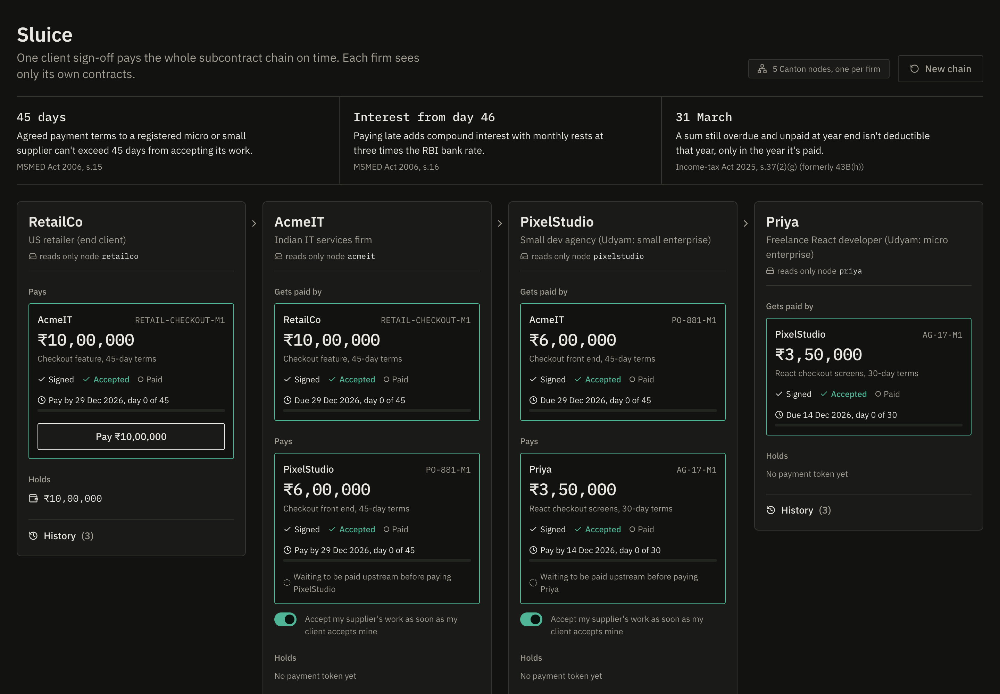

# ChainPay

**One client sign-off pays the whole subcontract chain on time, and no firm sees anyone else's contract.**

Built on Canton (Daml) for HackCanton Season 4, RWA & Business Workflows track.



## The problem

Indian IT work flows down chains: a US retailer pays an Indian IT firm, which pays a small agency, which pays a freelancer. Under Indian law, agreed payment terms to a registered micro or small supplier can't exceed **45 days from accepting its work** (MSMED Act s.15). Paying later adds compound interest at three times the RBI bank rate (s.16), and a sum still overdue and unpaid on 31 March isn't tax-deductible that year (Income-tax Act 2025 s.37(2)(g), formerly 43B(h)).

The client's sign-off rarely reaches the bottom of the chain on time. And no tier will share its contract to fix that, because the contract shows its margin.

## What ChainPay does

- Each link in the chain (client → IT firm → agency → freelancer) is its own Daml contract, signed by its two firms only.
- When the client accepts the work, each firm's automation accepts its supplier's work **back to back**, on its own node. That starts each tier's own 45-day clock, with its own due date.
- Each payer pays with a demo token and gets a receipt marked on time or late.
- Each firm gets its own history, read from its own node with the ledger's transaction ids, and can download it as CSV for its accountant.
- The ledger rejects terms over the legal cap. The cap is scenario data with its source, not code.

## How the privacy holds

- **One Canton participant node per firm.** The demo runs 5 nodes and 1 synchronizer locally. Each pane of the screen reads only from its firm's node.
- **No divulgence.** Accepting downstream passes the upstream milestone and time as plain values. It never fetches the upstream contract, so the upstream contract is never sent down the chain.
- **Exact payments.** A payer splits off the exact amount before paying, so a payee never sees the payer's balance.
- **Checked, not claimed.** The privacy check reads *everything that reached each node*, for any party, and looks for any contract or amount that firm isn't party to. Result of `npm run e2e`:

```
Privacy check (everything that reached each firm's own node):
  client     retailco       5 txs  10 events  own amounts [1000000]  ok
  prime      acmeit         9 txs  21 events  own amounts [1000000, 600000]  ok
  agency     pixelstudio    9 txs  21 events  own amounts [600000, 350000]  ok
  freelancer priya          4 txs   9 events  own amounts [350000]  ok
  bank       demobank       6 txs  13 events  own amounts []  ok

Which nodes hold each subcontract (of 5):
  RETAIL-CHECKOUT-M1   retailco, acmeit
  PO-881-M1            acmeit, pixelstudio
  AG-17-M1             pixelstudio, priya
```

The checker has its own tests that feed it planted leaks, so its "ok" means something.

## Business materials

- [One-page brief](docs/brief.md): problem, ICP, who pays, why Canton, why now
- [Validation and metrics](docs/validation.md): public evidence, what we tested, pilot success criteria
- [Go-to-market](docs/gtm.md): channels, pricing hypothesis, acquisition tests
- [Pilot plan](docs/pilot-plan.md): three steps with integrations and exit tests
- [Demo video script](docs/video-script.md): the 3-minute walkthrough, captions doubling as voiceover
- Pitch deck: 14 slides, source in `docs/deck/`

## What's here

| Path | What it is |
|---|---|
| `daml/chainpay` | The contracts: subcontract proposal and link, payment obligation, receipt, demo token |
| `daml/chainpay-tests` | Daml Script tests: back-to-back cascade, privacy at every stage, late payment, 8 guard cases |
| `app` | TypeScript on the Canton JSON Ledger API v2 (types generated from its OpenAPI spec): the local network launcher, chain setup, back-to-back automation, payments, privacy check, and the demo API |
| `ui` | The demo screen (Vite + React): four panes, one per firm |
| `data/demo-scenario.json` | The demo chain: firms, amounts, terms, and the legal rules shown on screen, with sources |
| `data/network.json` | The nodes, their ports, and which party each node hosts |

## Run it

Needs the Daml SDK (`dpm`) 3.7, Java 17+ and Node 22+. On Apple Silicon, also Rosetta 2. The Daml 3.7 compiler fails on paths that contain spaces, so clone into a path without them.

```bash
dpm build --all
cd daml/chainpay-tests && dpm test && cd ../..
```

```bash
cd app && npm install && cp .env.example .env
npm run network                   # own terminal: 5 participant nodes + 1 synchronizer
npm test                          # privacy checker self-tests
npm run e2e                       # set up, accept, cascade, pay, privacy check per node
```

```bash
npm run api                       # in app/, own terminal
cd ../ui && npm install && npm run dev
```

All ports and settings live in `app/.env` and `data/network.json`. To use one `dpm sandbox` instead of the network, set `LEDGER_TOPOLOGY=sandbox`.

## Honest limits

- Payments use a **demo token**, not money. Real firms would settle in INR over bank rails, with Canton holding the acceptances, obligations and proof of payment.
- The rules apply only to suppliers registered (Udyam) as micro or small enterprises; the demo firms are stated as registered. ChainPay tracks dates. It isn't tax or legal advice.
- The token's issuer sees token movements, as a bank would. It never sees a subcontract.
- A back-to-back acceptance carries the upstream milestone id and acceptance time as proof of why it happened. So a payee learns *that* its payer's own client accepted, and when, but never the upstream contract, parties' terms or amount.
- The network runs every node on one machine, in memory. It shows what each node receives; it isn't a production deployment.
- The on-screen clock counts real days. The demo doesn't fast-forward time; late payment is covered by the Daml tests.
- No user interviews were run.
